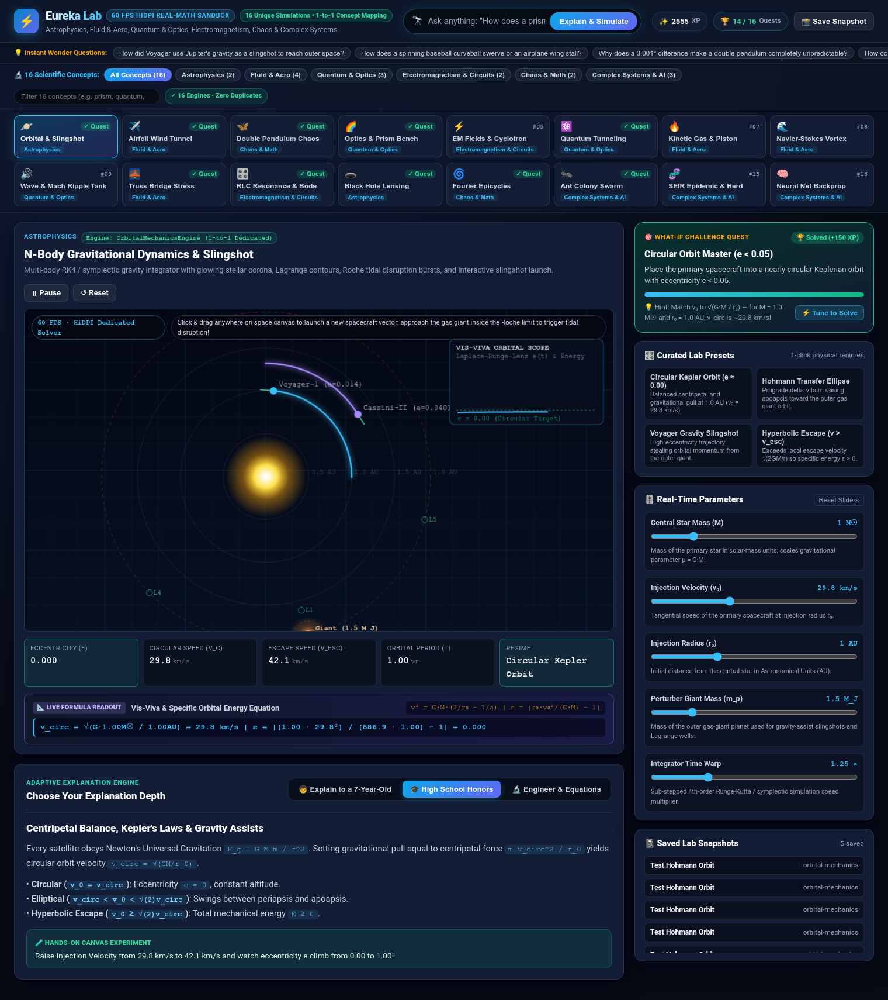
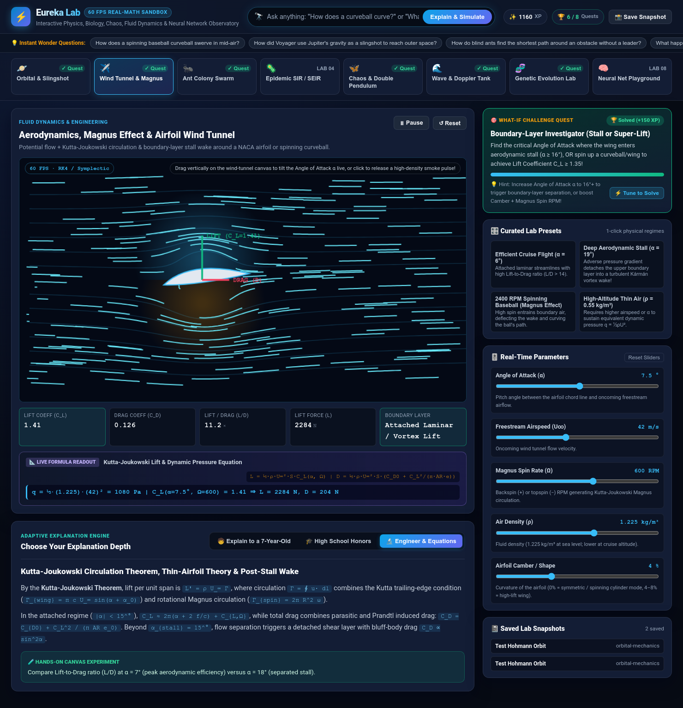
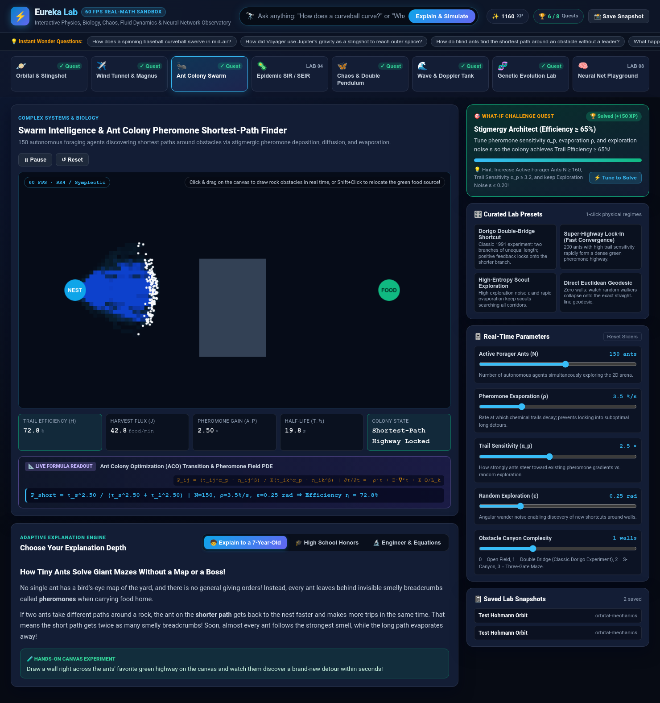
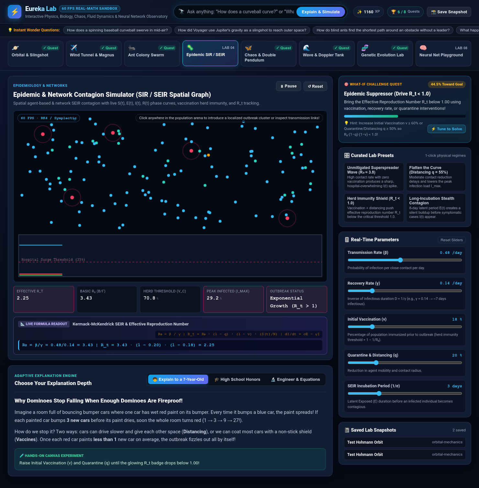
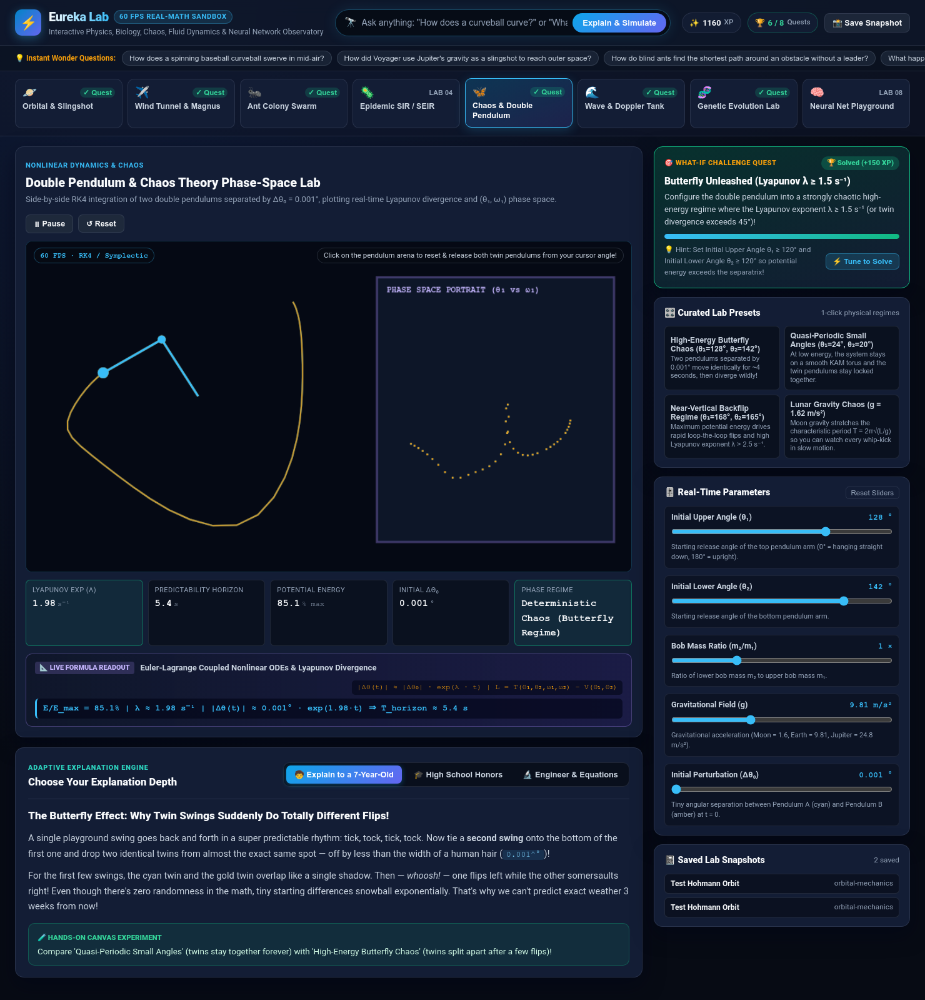
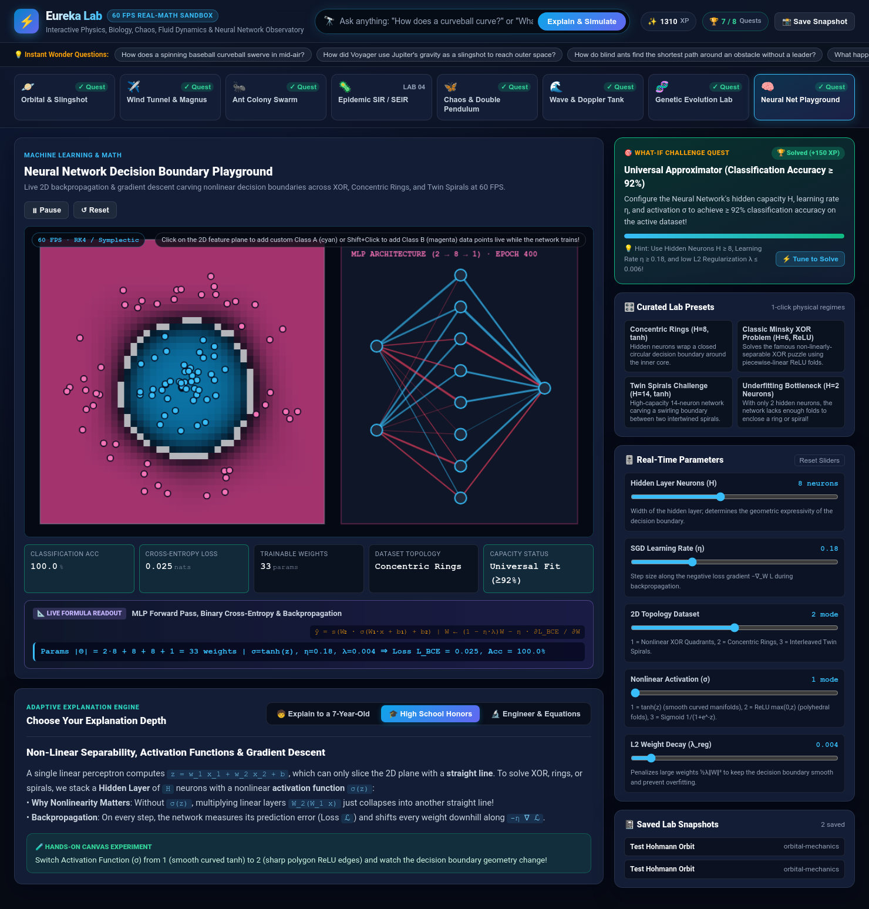

# ⚡ Eureka Lab (`eureka-lab`)

**Eureka Lab** is an interactive **"Explain & Simulate Anything"** Physics, Biology, Chaos Theory, Fluid Dynamics, Wave Mechanics & Machine Learning Observatory running on **port `8096`** (`EUREKA_PORT`).

Ask any natural-language *"How does X work?"* or *"What happens if..."* science question — or dive directly into **8 real-math 60 FPS HTML5 Canvas laboratories** paired with a **3-Tier Adaptive Explanation Engine**, **Live Substituted Formula Readouts**, and **What-If Challenge Quests**.

---

## 🖼️ Visual Tour & Screenshots

| Orbital Mechanics & Gravity Slingshot Lab | Aerodynamics, Magnus Effect & Wind Tunnel |
| :---: | :---: |
|  |  |
| **Swarm Intelligence & Ant Colony Shortest-Path** | **Epidemic & Network Contagion (SIR / SEIR)** |
|  |  |
| **Double Pendulum & Chaos Theory Phase-Space** | **Neural Network Decision Boundary Playground** |
|  |  |

---

## 🔬 The 8 Real-Math Interactive Laboratories

1. **🪐 Orbital Mechanics & Gravity Slingshot Lab (`orbital-mechanics`)**
   - **Numerical Engine**: 2nd-order symplectic Velocity-Verlet N-body gravitational integrator with central star ($M_\odot$), gas-giant perturber ($M_J$), and $L_4/L_5$ Lagrange markers.
   - **Interactive Canvas**: Click & drag anywhere in space to launch new probes/comets with custom velocity vectors.
   - **Live Formula**: Vis-Viva & Laplace-Runge-Lenz Eccentricity ($v^2 = GM(2/r_0 - 1/a)$).
2. **✈️ Aerodynamics, Magnus Effect & Airfoil Wind Tunnel (`aerodynamics-wind-tunnel`)**
   - **Numerical Engine**: Potential doublet flow superposed with Kutta-Joukowski vortex circulation $\Gamma$, thin-airfoil camber lift, Magnus spin circulation ($\Omega$ RPM), and post-stall Kármán vortex wake separation ($\alpha \ge 16^\circ$).
   - **Interactive Canvas**: Click anywhere to inject high-density smoke tracer pulses; watch live Lift ($L$) and Drag ($D$) vectors.
3. **🐜 Swarm Intelligence & Ant Colony Pheromone Shortest-Path Finder (`ant-colony-swarm`)**
   - **Numerical Engine**: 150 autonomous foraging agents coupled to a 2D reaction-diffusion chemotaxis grid ($\partial\tau/\partial t = -\rho\tau + D\nabla^2\tau + \sum q_k$).
   - **Interactive Canvas**: Click & drag to paint rock walls live on the arena, or `Shift+Click` to move the food source.
4. **🦠 Epidemic & Network Contagion Simulator (`epidemic-contagion-sir`)**
   - **Numerical Engine**: Spatial moving-agent SEIR contagion with vaccination herd-immunity shields, quarantine mobility reduction, and live $S(t), E(t), I(t), R(t)$ curves plotted against hospital surge capacity.
   - **Interactive Canvas**: Click on the population arena to introduce a localized outbreak cluster.
5. **🦋 Double Pendulum & Chaos Theory Phase-Space Lab (`double-pendulum-chaos`)**
   - **Numerical Engine**: Side-by-side 4th-order Runge-Kutta (RK4) integration of twin Euler-Lagrange double pendulums separated by $\Delta\theta_0 = 0.001^\circ$, with real-time $(\theta_1, \omega_1)$ phase-space portrait and maximal Lyapunov exponent $\lambda$.
6. **🌊 Wave Interference, Doppler Effect & Acoustic Harmonics Tank (`wave-interference-doppler`)**
   - **Numerical Engine**: Two-source Young interference tank + moving Doppler / supersonic Mach cone wavefronts ($\sin\theta_M = c/v_s$) + $K$-mode Fourier harmonic synthesizer with optional **Web Audio API** sound synthesis.
7. **🧬 Genetic Evolution & Natural Selection Ecosystem (`genetic-evolution-ecosystem`)**
   - **Numerical Engine**: Continuous-space evolutionary ecosystem governed by Lande's Breeder Equation ($\Delta\bar{z} = h^2 S$) and quadratic metabolic speed cost ($P_{\text{met}} \propto c_v v^2$), with a live phenotypic trait histogram.
8. **🧠 Neural Network Decision Boundary Playground (`neural-network-playground`)**
   - **Numerical Engine**: Live 2-layer Multilayer Perceptron ($2 \to H \to 1$) running forward propagation and backpropagation gradient descent at 60 FPS across Nonlinear XOR, Concentric Rings, and Twin Spirals.

---

## 🚀 Quick Start

```bash
# 1. One-command launcher (creates .venv, installs deps, starts on port 8096)
./run.sh

# 2. Or start directly via Run Nexus entrypoint
python3 server.py
```

Open **`http://127.0.0.1:8096`** in your browser.

---

## 🧪 Self-Check & Automated Test Suite

```bash
# Run environment & physics engine diagnostics
.venv/bin/python scripts/selfcheck.py

# Run unit, API smoke, and headless Chromium Playwright E2E tests
.venv/bin/pytest -q
```

---

## 📄 License

MIT License — see [LICENSE](LICENSE).
